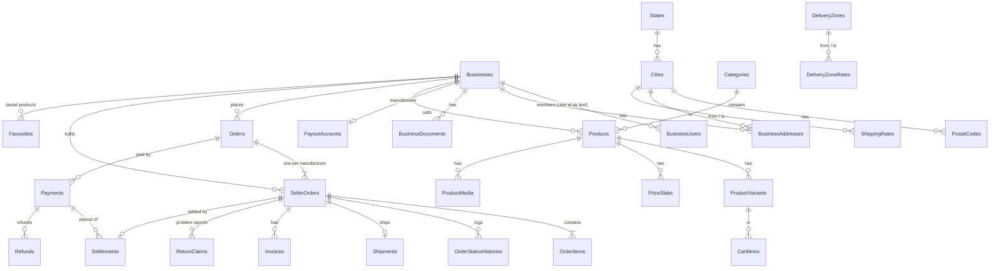

# ARCHITECTURE.md — TextileConnect

How the system is built, as it is in the code on 17 Nov 2026. Where a part is planned but not built, it says so.
Generated and detailed documents: [DATA_MODEL.md](DATA_MODEL.md) (every table), [API_REFERENCE.md](API_REFERENCE.md) (every route), [openapi.json](openapi.json) (the contract for the frontend), [SETTLEMENT.md](SETTLEMENT.md) (money rules), [AUDIT.md](AUDIT.md), [SEARCH.md](SEARCH.md), [MEDIA.md](MEDIA.md), [MASTER_DATA.md](MASTER_DATA.md), [SECURITY_REVIEW.md](SECURITY_REVIEW.md), [DEPLOY.md](DEPLOY.md), [TESTING.md](TESTING.md), [INVOICING.md](INVOICING.md).
Rules for working are in `AGENTS.md`; the task list and its honest status are in `docs/PHASES.md`.

---

## 1. Overview

A multi-vendor B2B marketplace for textiles in India. Verified manufacturers list wholesale products; verified retailers (shops) order in bulk; the platform takes a commission per order. The platform company can also sell through its own seller business (`IsPlatformOwned`).

**Roles:** Admin, Retailer, Manufacturer.

**What works end to end** (shown by `FullJourneyHttpTests`, over HTTP, with data made only through the API): mobile OTP sign-in, business sign-up and admin approval, products with sizes, colours and price tiers, search and filters, landed cost with freight and GST, cart, checkout split per seller, payment (fake gateway), seller accept, reject or dispatch, retailer delivery confirmation, payout hold and release (status only), problem reports with photos and refunds, notifications, seller dashboard, admin lists and reports.

**Not built:** real SMS (MSG91), WhatsApp, real file storage (R2), real money transfer to sellers (Razorpay Route), product reviews, group buying, a logistics role. **Built but switched off until the owner turns it on** (`Feature.*` settings): requests for quotation ([RFQ.md](RFQ.md)). See `PHASES.md`.

---

## 2. System architecture

```
React + Vite PWA (client/)        retailer, manufacturer, admin areas
        |  HTTPS, auth cookie + X-CSRF-TOKEN header
        v
TextileConnect.Api                minimal API endpoint files (no controllers), middleware, rate limiting, /api/v1
        |
        +--> Sanfiqo.Identity      users, roles, OTP, contact ownership, cookie security (own database)
        +--> TextileConnect.Application   services, rules, interfaces
                 |
                 v
        TextileConnect.Infrastructure     EF Core (MySQL), services, Razorpay client, photo copies (SkiaSharp), development file storage
                 |
                 v
              MySQL 8   (marketplace database + identity database)
```

Dependency direction: Api -> Application / Infrastructure / Sanfiqo.Identity; Infrastructure -> Application -> Domain. Domain references nothing.

External: Razorpay (order, refund, webhook; needs real keys in Production). Planned, not built: MSG91, WhatsApp Cloud API, Razorpay Route, Cloudflare R2.
The frontend never calls an external service directly. In every environment except Development and Testing the app **refuses to start** while a development adapter (file storage, payment gateway, OTP sender) is still in place (`ProductionAdapterGuard`).

### Tech stack
| Layer | Choice | Status |
| --- | --- | --- |
| Runtime | .NET 10, ASP.NET Core minimal APIs | built |
| Database | MySQL 8 through EF Core and `MySql.EntityFrameworkCore`; migrations applied by `dotnet ef`, never by the app | built |
| Auth | ASP.NET Core Identity + mobile OTP + HttpOnly cookie (SameSite=Lax) + antiforgery header; no JWT | built |
| Validation | FluentValidation and explicit rule checks | built |
| Background work | `BackgroundService` (`OrderMaintenanceWorker`, every minute: expiry of unaccepted and unpaid orders, refund retries, payout release) | built |
| Logging | Serilog, one JSON line per request in production, correlation id, no secrets (see section 8) | built; sink and error tracker not chosen |
| Images | SkiaSharp (MIT): square WebP copies and a blur preview | built |
| SMS | MSG91 behind `IOtpDelivery`; only a fake sender exists | planned |
| WhatsApp | behind `INotificationSender`; nothing calls it | planned |
| Payments | Razorpay behind `IPaymentGateway` (orders, refunds, webhook); the fake gateway is the one used in tests | partly built |
| Files | `IFileStorage`; only the local disk implementation for Development | planned (R2) |
| Frontend | React + Vite + TypeScript PWA, Tailwind, shadcn/ui, TanStack Query | built, see `client/` |
| Hosting | Docker image + MySQL; see DEPLOY.md | written, not run |

The frontend and the API must be on the same site (for example `app.example.in` and `api.example.in`) so that the cookie works.

---

## 3. Data model

Every table, column, key, foreign key and index is in [DATA_MODEL.md](DATA_MODEL.md), made from the EF model by a test, so it cannot drift. The shape:



Conventions:
- Business tables use `BIGINT` auto number keys. Users keep their text id (identity database), so no business table has a foreign key to a user.
- Every relation between business tables is a real foreign key with `ON DELETE RESTRICT`; rows are soft deleted (`IsDeleted`) or kept, never cascaded.
- Money `decimal(18,2)`, one rounding rule (half away from zero). Times UTC. Created and changed times are filled by `MarketplaceDbContext` on save.
- Statuses are text constants in `TextileConnect.Domain` (`SellerOrderStatus`, `PaymentStatus`, `SettlementStatus`, `RefundStatus`, `ShipmentProgress`); saving any other text is refused.
- Order lines keep a snapshot of title, size, colour, price and GST at checkout. An order keeps its own copy of the delivery address.
- Run `docs/FK_ORPHAN_CHECK.sql` before applying the foreign key migration to a database that already holds data.

---

## 4. Business rules (each is enforced in the services and covered by tests)

1. A business that is not Approved cannot list products or order (policy `ApprovedBusiness` plus checks in the services).
2. Quantity per product must reach the MOQ; the price tier is chosen by the **total** quantity of the product across sizes and colours.
3. The server recomputes every price, freight, GST and commission at checkout. Client totals are ignored.
4. Commission = goods subtotal x (seller's own rate, else the setting `Commission.DefaultRate`), frozen on the order when it is placed. The retailer pays goods + GST + freight; the commission is taken from the seller's payout. Details and the open questions are in SETTLEMENT.md.
5. Seller order moves are defined once (`SellerOrderTransitions`): Pending to Accepted, Rejected or Cancelled; Accepted to Dispatched; Dispatched to Delivered; the rest are final. Only the retailer can mark delivery.
6. A seller has 24 hours to accept; an unpaid order is cancelled after 60 minutes (settings). A payment that arrives after cancellation is refunded.
7. The payout is held until delivery is confirmed or 7 days after dispatch, and while a problem report is open. (It is a status change: no money moves to the seller yet.)
8. Checkout and payments are idempotent per `Idempotency-Key`; a webhook event is applied once.
9. Stock is reserved at checkout (a concurrency check on the stock count), and given back when an order is rejected or cancelled.
10. Every query for business data is filtered by the signed-in business; `IdorWalkTests` calls every route that takes an id as a business that owns nothing.
11. Every money, approval, moderation and configuration action is written to the audit log (AUDIT.md).

### 4b. Added on 17-18 Nov 2026
12. **Feature switches.** Optional parts are off until the owner switches them on (`Feature.<name>` platform settings, `GET /api/v1/features`, admin `PUT /api/v1/admin/features/{name}`). A route of a switched-off part answers 404 `feature_off`. Today the only switch is `Rfq`.
13. **Requests for quotation** ([RFQ.md](RFQ.md)): a retailer asks, manufacturers quote, the retailer accepts one; the two are then shown each other's contact. No payable order comes out of it yet.
14. **GST documents** ([INVOICING.md](INVOICING.md)): tax invoice per seller order after dispatch, credit note per processed refund, platform fee tax invoice (when the platform company is set up), a register for the accountant (CSV and JSON). Each document keeps the figures that were printed.
15. **Stored prices on the product.** `Product.PriceFrom` and `PriceTo` are the lowest and highest price of the price tiers and are set by `MarketplaceDbContext` on every save, never by hand. A product without a tier has no price and is not listed. The list and the filter counts read these columns.
16. **Filter counts** come from one in-memory copy of the listed products, kept for 30 seconds when the host has a memory cache (`CatalogueFacetSnapshot.cs`); a catalogue above 50,000 products is counted by SQL as before. Measured numbers and what is still slow are in [PERFORMANCE.md](PERFORMANCE.md).

## 5. Landed cost
Price a retailer sees for a pincode: tier price + GST on it + freight. Freight comes from the rate between the pincode zones (first digit of the pincode) or, failing that, between the two cities; per piece or per kg with a minimum charge. No rate means "shipping on request" and checkout says "We cannot deliver to this address yet." Example: 200 pieces at 300, freight 20 a piece, GST 5% (15) gives 335 a piece.

## 6. Core flows
**A. Onboarding:** OTP request, OTP verify (cookie session), create business (Pending) with the owner, upload documents, admin approves or rejects with a note (the role is assigned on approval and the session refreshes without a new login).

**B. Order:** cart (several sellers) -> checkout checks MOQ, approval, stock and delivery pricing, then creates one Order and one SellerOrder per seller -> payment session -> payment confirmed (return from the gateway or webhook) -> each seller accepts or rejects within 24 hours (a rejection refunds that seller order only).

**C. Fulfilment:** seller dispatches with an LR number -> may note InTransit or ReachedCity -> retailer confirms delivery -> the payout is released by the per-minute job (or 7 days after dispatch) -> sales counter of each product goes up.

**D. Problem:** retailer reports a problem with photos -> payout held -> seller replies -> admin decides (refund 0 or part) -> payout minus the refund released.

## 7. API
`/api/v1`, JSON, errors always `{ code, message, fields? }`. The full list with who may call each route is [API_REFERENCE.md](API_REFERENCE.md); the schemas are in [openapi.json](openapi.json); screen by screen notes are in [API_SCREENS.md](API_SCREENS.md). Health: `/api/v1/health` and `/health/live` (process is running), `/health/ready` (database and storage work).

## 8. Security (the review is in SECURITY_REVIEW.md)
- Cookie: HttpOnly, Secure outside Development, SameSite=Lax; antiforgery header on every changing call; one-time codes hashed, 5 minutes, single use, 5 wrong tries, limits per number and per address.
- Rate limits are per client address (sign-in, search, and an overall limit); the address is trusted from `X-Forwarded-For` only from proxies named in configuration.
- Ownership is checked in every service, not only by role; roles are checked by policy.
- Uploads are judged by their first bytes and size; photos are decoded and re-encoded into copies.
- Secrets live in user-secrets or environment variables, never in a file in git. Webhooks are verified by signature.
- Headers on every answer: nosniff, no framing, no-referrer, a CSP of `default-src 'none'`, no-store for private answers, HSTS outside Development.
- Logs hold method, path (no query string), status, time, user id and client address under a correlation id; never bodies, codes, numbers or tokens.
- Admin second step: a code from an authenticator app after the mobile code (`Auth:AdminMfa`, off by default; an unconfirmed admin session has no Admin role). Not done yet: signed URLs for private files (needs R2), a secret scanner and a penetration test.

| Action | Admin | Retailer | Manufacturer |
| --- | --- | --- | --- |
| Approve businesses, settings, moderation | Yes | No | No |
| Browse products, landed cost | Yes | Yes | Yes |
| Create and edit own products and photos | No | No | Yes (approved) |
| Cart, checkout, pay, confirm delivery, report a problem | No | Yes (approved) | No |
| View orders | All | Own business | Own seller orders |
| Accept, reject, dispatch | No | No | Own only |

## 9. Open decisions
See the list in `PHASES.md` ("Open decisions"): who bears the commission, the payout delay, brand name and domain, the PDF library for invoices, the log sink and error tracker, the source of the pincode directory.
