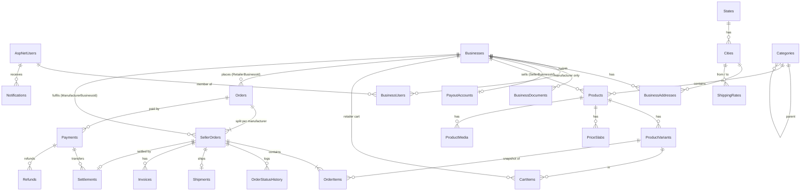

# ARCHITECTURE.md — TextileConnect

Source of truth for data model, flows and API. If this file and code disagree, ask before changing either.
Rules for working are in `AGENTS.md`; the task list is in `docs/PHASES.md`.

Last updated: 2026-11-12. Decisions changed since the first draft: .NET 10 (not 8/9), `MySql.EntityFrameworkCore`
(not Pomelo), cookie auth reused from the old project (no JWT, no refresh tokens).

---

## 1. Overview

Multi-vendor B2B marketplace. Verified manufacturers list wholesale textiles; verified retailers in Jammu & Kashmir
order in bulk; the platform takes a commission per order. The platform company can also sell its own stock through a
seller business with `IsPlatformOwned = true`.

**Roles:** Admin, Retailer, Manufacturer (later Logistics).

**MVP scope:** mobile OTP login, business registration + admin approval, categories, products, variants, price slabs,
MOQ, search/filters, Kashmir landed cost calculator, cart, checkout split per manufacturer, Razorpay Route payment with
split settlement, order tracking, WhatsApp notifications.

**Not in MVP:** RFQ/quotations, disputes, reviews, favourites, collective buying, negotiation, logistics role,
credit, inspections, analytics.

---

## 2. System architecture

```
React + Vite PWA (client/)        retailer, manufacturer, admin areas
        |  HTTPS, auth cookie + X-CSRF-TOKEN header
        v
TextileConnect.Api                controllers, middleware, rate limiting, Swagger, /api/v1
        |
        +--> Sanfiqo.Identity      users, roles, OTP, contact ownership, cookie security
        +--> TextileConnect.Application   services, DTOs, validators, interfaces
                 |
                 v
        TextileConnect.Infrastructure     EF Core DbContext (MySQL), file storage, MSG91, WhatsApp, Razorpay, Hangfire
                 |
                 v
              MySQL 8

External: MSG91 (OTP SMS), WhatsApp Cloud API (alerts), Razorpay Route (payments + split payouts)
Razorpay -> POST /api/v1/webhooks/razorpay (signature verified, idempotent)
```

Frontend never calls external services directly. All money/SMS/WhatsApp traffic goes through the API.

### Tech stack
| Layer | Choice |
| --- | --- |
| Runtime | .NET 10, ASP.NET Core Web API (controllers) |
| ORM / DB | EF Core + `MySql.EntityFrameworkCore`, MySQL 8 |
| Auth | ASP.NET Core Identity + mobile OTP + HttpOnly secure cookie (SameSite=Lax) + antiforgery |
| Validation | FluentValidation |
| Jobs | Hangfire (MySQL storage) |
| Logging | Serilog |
| SMS | MSG91 (DLT) behind `IOtpSender` |
| WhatsApp | Meta WhatsApp Cloud API behind `INotificationSender` |
| Payments | Razorpay Route behind `IPaymentGateway` |
| Files | Cloudflare R2 behind `IFileStorage` (local disk in Development) |
| Frontend | React + Vite + TypeScript PWA, Tailwind, shadcn/ui, TanStack Query |
| Hosting | DigitalOcean or Azure, India region |

Cookie note: frontend and API must be same-site (e.g. `app.example.in` + `api.example.in`) so the cookie works.
JWT is added only if a native mobile app is built later.

---

## 3. Data model

### Conventions
- Business tables: `BIGINT` auto-increment `Id`. Identity users: string Id (as in Sanfiqo.Identity).
- Money `decimal(18,2)`. Times UTC. `CreatedAt`, `UpdatedAt` on every table.
- Enums stored as int. Soft delete `IsDeleted` on Businesses and Products.
- Table names plural, PascalCase.

### ER diagram (core)


### 3.1 Identity (from Sanfiqo.Identity — keep its existing schema)
| Table | Key columns | Notes |
| --- | --- | --- |
| AspNetUsers (ApplicationUser) | Id, PhoneNumber (unique), UserName, IsActive, CreatedAt, LastLoginAt | Add FullName, PreferredLanguage (en/hi/ur). No business fields here. |
| AspNetRoles, AspNetUserRoles | Standard | Roles: Admin, Retailer, Manufacturer |
| OTP + contact tables | As in old project, renamed from Customer* | Keep expiry, single use, attempt limits, hashed storage |
| DataProtectionKeys | Id, FriendlyName, Xml | Persist Data Protection keys (P1.10) |

### 3.2 Businesses
| Table | Key columns | Relationships |
| --- | --- | --- |
| Businesses | Id, BusinessType (Retailer/Manufacturer/Logistics), LegalName, DisplayName, GSTIN (unique, nullable), PAN, Phone, Email, VerificationStatus (Pending/Approved/Rejected/Suspended), RejectionNote, IsPlatformOwned, CommissionRateOverride (nullable), AvgRating, ApprovedByUserId, ApprovedAt, IsDeleted | Hub of the model |
| BusinessUsers | BusinessId (FK), UserId (FK), BusinessRole (Owner/Staff), IsPrimary; PK (BusinessId, UserId) | Users act for a business through this |
| BusinessAddresses | Id, BusinessId (FK), AddressType (Registered/Pickup/Delivery), Line1, Line2, CityId (FK), Pincode, IsDefault | Many -> 1 Business, many -> 1 City |
| BusinessDocuments | Id, BusinessId (FK), DocType (GST/PAN/ShopLicence/Udyam), FileKey, Status (Pending/Accepted/Rejected), ReviewedByUserId, ReviewNote | Files private |
| PayoutAccounts | Id, BusinessId (FK, unique), Gateway, GatewayLinkedAccountId, Status | Manufacturer only. No bank numbers stored. |

### 3.3 Master data
| Table | Key columns | Notes |
| --- | --- | --- |
| States | Id, Name, Code | |
| Cities | Id, StateId (FK), Name, IsDeliveryZone, IsSourcingHub | Seed J&K cities + sourcing hubs |
| Categories | Id, ParentId (FK self, nullable), Name, Slug (unique), SortOrder, IsActive | Tree |
| PlatformSettings | Key (PK), Value, UpdatedByUserId | e.g. `Commission.DefaultRate`, `Settlement.AutoReleaseDays` |

### 3.4 Catalogue
| Table | Key columns | Notes |
| --- | --- | --- |
| Products | Id, SellerBusinessId (FK), CategoryId (FK), Title, Slug (unique), Description, Material, FabricSpec, Season, HsnCode, GstRate, Moq, Unit (Piece/Set/Metre/Kg), WeightPerUnitGrams, DispatchDays, ReturnPolicy, Status (Draft/PendingReview/Active/Inactive), IsDeleted | Seller must be Manufacturer or IsPlatformOwned |
| ProductMedia | Id, ProductId (FK), FileKey, MediaType (Image/Video), SortOrder | |
| ProductVariants | Id, ProductId (FK), Sku (unique), Size, Colour, StockQty, IsActive | |
| PriceSlabs | Id, ProductId (FK), MinQty, MaxQty (nullable = and above), PricePerUnit | No overlaps; first MinQty = Moq |

### 3.5 Cart
| Table | Key columns | Notes |
| --- | --- | --- |
| CartItems | Id, RetailerBusinessId (FK), AddedByUserId (FK), VariantId (FK), Quantity | Cart belongs to the business, shared by staff |

### 3.6 Orders, shipping, payments
| Table | Key columns | Notes |
| --- | --- | --- |
| Orders | Id, OrderNumber (unique), RetailerBusinessId (FK), PlacedByUserId, DeliveryAddressId (FK), SubTotal, ShippingTotal, PlatformFeeTotal, TaxTotal, GrandTotal, PaymentStatus | One per checkout |
| SellerOrders | Id, OrderId (FK), ManufacturerBusinessId (FK), SubOrderNumber (unique), SubTotal, ShippingAmount, CommissionRate, CommissionAmount, TaxAmount, Total, Status, RejectReason, AcceptedAt, DispatchedAt, DeliveredAt | One per manufacturer per order |
| OrderItems | Id, SellerOrderId (FK), ProductId (FK), VariantId (FK), TitleSnapshot, Size, Colour, HsnCode, Quantity, UnitPrice, GstRate, LineTotal | Snapshots at checkout |
| OrderStatusHistory | Id, SellerOrderId (FK), Status, Note, ChangedByUserId, ChangedAt | Tracking timeline |
| ShippingRates | Id, FromCityId (FK), ToCityId (FK), RateType (PerKg/PerPiece), Rate, MinCharge, TransitDays, IsActive | Landed cost input |
| Shipments | Id, SellerOrderId (FK, unique), LogisticsBusinessId (nullable), CarrierName, LrNumber, DispatchedAt, DeliveredAt, ProofOfDeliveryKey | |
| Payments | Id, OrderId (FK), Gateway, GatewayOrderId (unique), GatewayPaymentId, Amount, Method, Status, PaidAt | Retries allowed |
| PaymentWebhookEvents | Id, Gateway, EventId (unique), EventType, ReceivedAt, ProcessedAt | Idempotency |
| Settlements | Id, PaymentId (FK), SellerOrderId (FK, unique), ManufacturerBusinessId (FK), Amount, CommissionAmount, GatewayTransferId, Status, ReleaseAfter, SettledAt | |
| Refunds | Id, PaymentId (FK), SellerOrderId (FK), Amount, Reason, GatewayRefundId, Status | |
| Invoices | Id, SellerOrderId (FK), InvoiceNumber (unique), InvoiceType (SellerToRetailer/PlatformCommission), FileKey, IssuedAt | |

### 3.7 Notifications and audit
| Table | Key columns | Notes |
| --- | --- | --- |
| Notifications | Id, UserId (FK), Channel (WhatsApp/SMS/InApp), TemplateKey, PayloadJson, Status, SentAt, ReadAt | |
| AuditLogs | Id, UserId, Action, EntityName, EntityId, OldValuesJson, NewValuesJson, IpAddress, CreatedAt | EF SaveChanges interceptor |

### 3.8 Later (Phase 7, do not build early)
Enquiries, Quotations, Disputes, Reviews, Favourites, GroupBuys, GroupBuyParticipants, NegotiationMessages,
Inspections, LogisticsQuotes, CreditLines, Subscriptions, PromotedListings.

---

## 4. Business rules
1. VerificationStatus != Approved -> cannot list products or place orders (policy `ApprovedBusiness` + service check).
2. Qty per product >= Moq. UnitPrice = PriceSlab where MinQty <= totalQty <= (MaxQty ?? infinity).
3. Server recalculates every price, shipping, GST and commission at checkout. Client totals are ignored.
4. Commission = SellerOrder.SubTotal x (Business.CommissionRateOverride ?? PlatformSettings `Commission.DefaultRate`).
5. Platform never holds funds: Razorpay collects, Route transfers to manufacturer linked account minus commission.
6. Settlement released after retailer confirms delivery, or after `Settlement.AutoReleaseDays` with no dispute.
7. Every status change -> OrderStatusHistory row + queued Notification.
8. All business data queries filtered by `ICurrentBusiness.BusinessId`. Admin bypasses with explicit admin endpoints only.
9. A rejected SellerOrder refunds only that SellerOrder's amount.

## 5. Landed cost
```
landedPerUnit = slabPrice
              + max(rate x totalWeightKg, minCharge) / qty     (PerKg)   or rate (PerPiece)
              + slabPrice x platformFeeRate                    (0 in MVP if manufacturer pays commission)
              + GST on slabPrice (product GstRate)
```
Rate from ShippingRates (manufacturer pickup city -> retailer delivery city). Missing rate -> return "shipping on request".
Example: 200 pcs at 300, freight 4,000 (20/pc), GST 5% (15) -> 335 per piece.

## 6. Core flows
**A. Onboarding:** request OTP -> verify -> cookie session -> create Business (Pending) + BusinessUsers (Owner)
-> upload documents -> admin approves (role assigned) or rejects with note -> WhatsApp to owner
-> manufacturer creates gateway linked account.

**B. Order:** retailer cart (multiple manufacturers) -> checkout validates MOQ/approval/stock, recalculates totals
-> Orders + SellerOrders + OrderItems -> Razorpay order -> payment -> webhook marks Paid
-> each manufacturer accepts or rejects within 24h (reject -> partial refund).

**C. Fulfilment:** dispatch with LR number -> In transit -> Reached Kashmir -> Delivered -> retailer confirms
(or auto) -> Hangfire releases Settlement -> invoices generated.

## 7. API (`/api/v1`, kebab-case)
| Module | Endpoints | Access |
| --- | --- | --- |
| Auth | POST auth/otp/request, POST auth/otp/verify, POST auth/logout, GET auth/me, GET auth/csrf | Public / logged in |
| Businesses | POST businesses, GET/PUT businesses/me, POST businesses/me/addresses, POST businesses/me/documents, POST businesses/me/users | Logged in |
| Admin | GET admin/businesses?status=, POST admin/businesses/{id}/approve, POST admin/businesses/{id}/reject, GET/PUT admin/settings, CRUD admin/shipping-rates | Admin |
| Master | GET categories, GET states, GET cities?zone= | Public |
| Products | GET products, GET products/{slug}, CRUD seller/products, PUT seller/products/{id}/slabs, POST seller/products/{id}/media | Public read; Manufacturer + Approved write |
| Landed cost | GET landed-cost?productId=&qty=&cityId= | Retailer |
| Cart | GET cart, POST cart/items, PUT cart/items/{id}, DELETE cart/items/{id} | Retailer + Approved |
| Orders | POST checkout, GET orders, GET orders/{id}, POST orders/{id}/confirm-delivery | Retailer |
| Seller orders | GET seller/orders, POST seller/orders/{id}/accept, /reject, /dispatch, /status | Manufacturer |
| Payments | POST payments, POST webhooks/razorpay | Retailer / gateway |
| Notifications | GET notifications, POST notifications/{id}/read | Logged in |

## 8. Security
- Cookie: HttpOnly, Secure, SameSite=Lax, fixed expiry (configure, default 8h), antiforgery header on unsafe methods.
- OTP: hashed, short expiry, single use, attempt + resend + IP limits (from old project).
- Data Protection keys persisted in DB before production.
- Ownership check in every service, not only `[Authorize(Roles=...)]`.
- Webhooks: signature verify + `PaymentWebhookEvents` idempotency.
- Secrets in user-secrets / environment variables only.
- Private documents via short-lived signed URLs.
- Rate limiting on auth and search. CORS only for the frontend origin. Daily MySQL backups.

| Action | Admin | Retailer | Manufacturer |
| --- | --- | --- | --- |
| Approve businesses, settings | Yes | No | No |
| Browse products, landed cost | Yes | Yes | Yes |
| Create/edit own products | No | No | Yes (Approved) |
| Cart, checkout | No | Yes (Approved) | No |
| View orders | All | Own business | Own SellerOrders |
| Accept/dispatch SellerOrder | Override | No | Own only |

## 9. Open decisions
- Who pays commission in MVP: manufacturer only (recommended) or shared?
- `Settlement.AutoReleaseDays` value.
- Brand name and domain.
